In March when I first released InTransit to the public, people were thrilled to see a modern metro transit app made specifically for India. Nobody had ever attempted this before, and of course I was foolish as ever to think I can do this. Well, I did, and it worked, and as a proof-of-concept that this is something people would use, it made sense to invest some more time in the app and improve how it works. 

So once I had completed all my iOS 27 and iPhone Duo updates for [Elytra](https://elytra.app) and [Pockity](https://pockity.app), I spent three works re-designing every single screen in InTransit, removing a lot of cruft from the app and polish up all the rough edges (there were so many!)

For this redesign, I decided to try the [Atomic Design](https://atomicdesign.bradfrost.com/chapter-2/) method popularized by Brad Frost. I built several small components (atoms), gradually composing them into larger components (molecules). I then skipped the "organisms" step, directly jumping to templates and pages as Brad describes in his document. 

<picture>
  <source media="(max-width: 600px) and (prefers-color-scheme: dark)"
    srcset="/assets/images/posts/20261110/atoms-dark-400w.webp 1x, /assets/images/posts/20261110/atoms-dark-800w.webp 2x, /assets/images/posts/20261110/atoms-dark-1200w.webp 3x"
    width="402" height="1938"
    type="image/webp"/>
  <source media="(min-width: 601px) and (max-width: 800px) and (prefers-color-scheme: dark)"
    srcset="/assets/images/posts/20261110/atoms-dark-800w.webp 1x, /assets/images/posts/20261110/atoms-dark-1600w.webp 2x, /assets/images/posts/20261110/atoms-dark@3x.webp 3x"
    width="402" height="1938"
    type="image/webp"/>
  <source media="(prefers-color-scheme: dark)" type="image/webp"
    srcset="/assets/images/posts/20261110/atoms-dark.webp 1x, /assets/images/posts/20261110/atoms-dark@2x.webp 2x, /assets/images/posts/20261110/atoms-dark@3x.webp 3x"
    width="402" height="1938"/>
  <source media="(max-width: 600px)"
    srcset="/assets/images/posts/20261110/atoms-400w.webp 1x, /assets/images/posts/20261110/atoms-800w.webp 2x, /assets/images/posts/20261110/atoms-1200w.webp 3x"
    type="image/webp"/>
  <source media="(min-width: 601px) and (max-width: 800px)"
    srcset="/assets/images/posts/20261110/atoms-800w.webp 1x, /assets/images/posts/20261110/atoms-1600w.webp 2x, /assets/images/posts/20261110/atoms@3x.webp 3x"
    type="image/webp"/>
  <source type="image/webp"
    srcset="/assets/images/posts/20261110/atoms.webp 1x, /assets/images/posts/20261110/atoms@2x.webp 2x, /assets/images/posts/20261110/atoms@3x.webp 3x"/>
  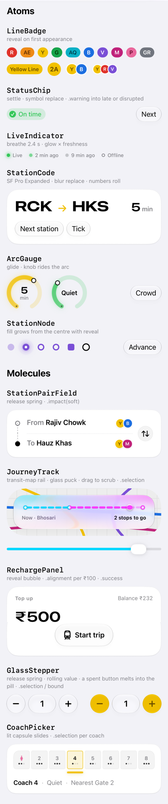
</picture>

Something else I focused early on were the micro and macro interactions for these molecules. However, unnecessary motion sometimes introduces additional cognitive load for some people. While most people who go through this have "Reduced Motion" enabled on their iPhones, some don't. So to be careful as to not overdo any of the interaction animations, I kept them intentionally subtle. 

> You'll miss it if you blink… and that's okay 

None of these interaction animations convey state, they only animate a molecule from one state to another. 

<picture>
  <source media="(max-width: 600px) and (prefers-color-scheme: dark)"
    srcset="/assets/images/posts/20261110/molecules-dark-400w.webp 1x, /assets/images/posts/20261110/molecules-dark-800w.webp 2x, /assets/images/posts/20261110/molecules-dark-1200w.webp 3x"
    width="402" height="1518"
    type="image/webp"/>
  <source media="(min-width: 601px) and (max-width: 800px) and (prefers-color-scheme: dark)"
    srcset="/assets/images/posts/20261110/molecules-dark-800w.webp 1x, /assets/images/posts/20261110/molecules-dark-1600w.webp 2x, /assets/images/posts/20261110/molecules-dark@3x.webp 3x"
    width="402" height="1518"
    type="image/webp"/>
  <source media="(prefers-color-scheme: dark)" type="image/webp"
    srcset="/assets/images/posts/20261110/molecules-dark.webp 1x, /assets/images/posts/20261110/molecules-dark@2x.webp 2x, /assets/images/posts/20261110/molecules-dark@3x.webp 3x"
    width="402" height="1518"/>
  <source media="(max-width: 600px)"
    srcset="/assets/images/posts/20261110/molecules-400w.webp 1x, /assets/images/posts/20261110/molecules-800w.webp 2x, /assets/images/posts/20261110/molecules-1200w.webp 3x"
    type="image/webp"/>
  <source media="(min-width: 601px) and (max-width: 800px)"
    srcset="/assets/images/posts/20261110/molecules-800w.webp 1x, /assets/images/posts/20261110/molecules-1600w.webp 2x, /assets/images/posts/20261110/molecules@3x.webp 3x"
    type="image/webp"/>
  <source type="image/webp"
    srcset="/assets/images/posts/20261110/molecules.webp 1x, /assets/images/posts/20261110/molecules@2x.webp 2x, /assets/images/posts/20261110/molecules@3x.webp 3x"/>
  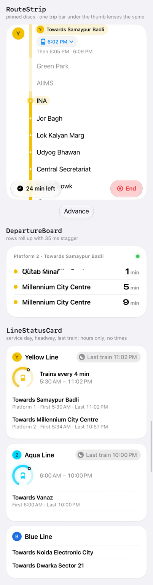
</picture>

Once these were composed, I wanted to then do a few critical things that always kept me from using InTransit properly, and so naturally other users definitely found it annoying too:
- **Search for stations**: This was needlessly separated into Stations and Places. The user would need to be mindful of which section they are searching in. Never a good idea. The new design unifies both, matches the name directly, and if nothing matches, it immediately begins to searching for places. 
- **Configuring a ride**: My second pain point: Selecting the departure and arrival stations quickly enough, that I can figure out my next *steps* in the real world based on the timing information. This is only possible if most of this information is presented to me upfront: i.e. no swiping, no taps, nothing. The app must recognize intent, not just taps. 
- **The Journey**: A lot of stations in India which are above ground are thick metal cages, leading to loss of GPS accuracy. This makes it hard for the app to determine if the user is actually at the station platform, outside of it, or somewhere else entirely. Determining this becomes harder still for underground stations. v2026.9 of InTransit employed motion detection to understand if you're walking or running towards the platform, or if you're in the metro carriages and moving towards your destination. v2026.11 now also uses the same technique to auto-start the journey for you. 
- **Better Timings**: Metro corporations across regions will have different timings, and special timings during civic holidays and festivities. A new timings system coordinates with these dynamic timings and I'll be putting more effort towards improving this information and data. 







InTransit's new design was built on top of these foundational molecules and organisms. The new design speaks for itself, feels fresh and causes less cognitive load while interacting with it. It is also now more robust than ever at handling complex inter-line transits. 

<aside>You may have also noted some common elements from <a href="https://pockity.app/ios" target="_blank" title="Pockity for iOS, iPadOS, and watchOS">Pockity</a> used in InTransit. Helps to have a shared UI library of components.</aside>

Thank you for reading this far, if you haven't already do check out the update on the [AppStore](https://apps.apple.com/us/app/intransit/id6756531079), and at the time of writing, it's the only app showing the newly active Pink Line from Pune 😉

--- 

For those curious about how the two designs and layouts compare, here's a full chart for your exploration:

| Name | Old | New |
| --- | --- | --- |
| Map | 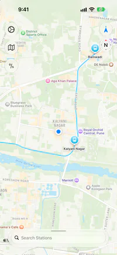 | 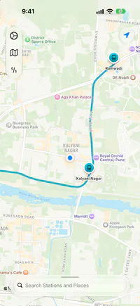 |
| Search | 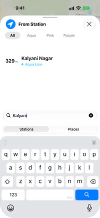 | 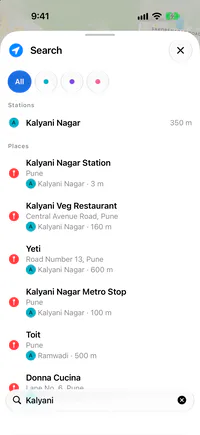 |
| Station Details | 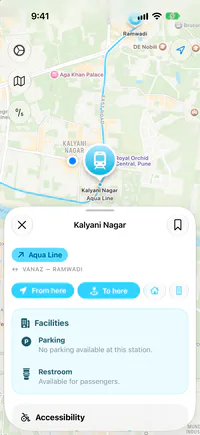 | 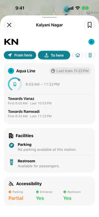 |
| Configuring a Ride | 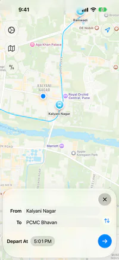 | 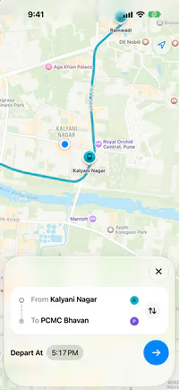 |
| Route Info | 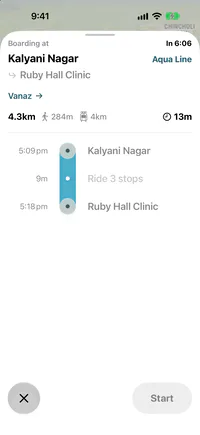 | 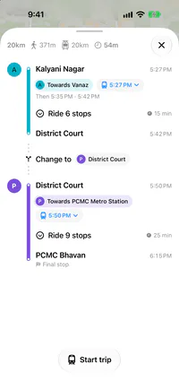 |
| Trip Details | 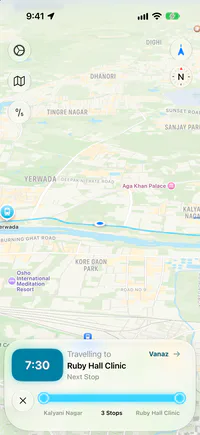 | 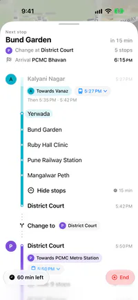 |
| Live Activity | 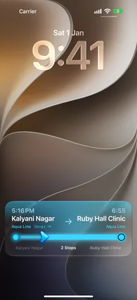 | 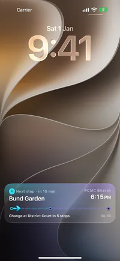 |
| End Trip | 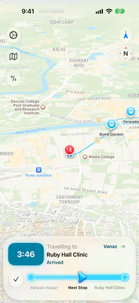 | 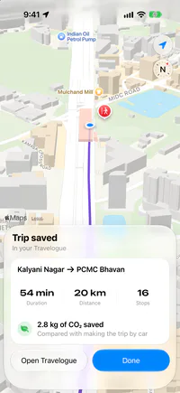 |
| Travelogue | 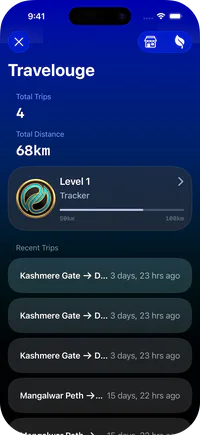 | 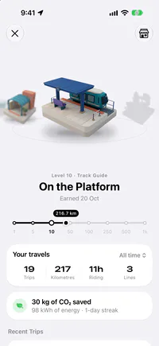 |
